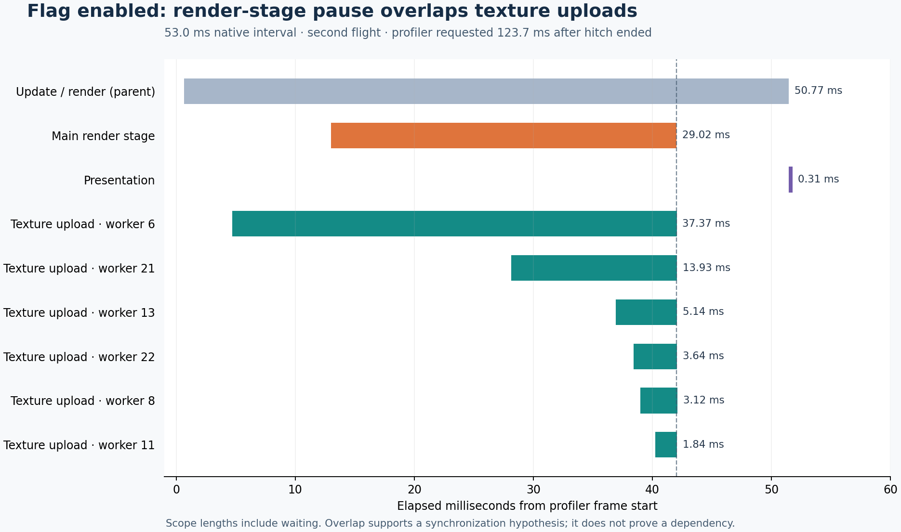

# Where the flag-on stutters occurred

Subsequent update: [WPR/VRAM diagnosis and reusable tracing](WPR-VRAM.md) installed a protected on-demand tracing task, validated complete kernel trace coverage, and identified graphics-memory preparation blocking presentation with substantial VRAM free. A matched lower-texture diagnostic reduced accepted-window pauses from 18 to 2 but did not eliminate them. This supersedes the earlier elevation blocker; the earlier untraced measurements retain their original limits.

The strongest current lead is **a rendering/texture-streaming synchronization stall**. One reproduced pause was captured inside X-Plane's update/render work while several background texture uploads finished together. A separate maximum/lower/maximum texture experiment reproduced pauses at maximum detail on both sides of a quiet lower-detail pair. This narrows the problem; it does not identify the exact lock, driver operation, disk access or Windows scheduling event responsible.

The flag and 10 GB cache remain saved. **Original maximum texture detail is restored.** No driver, background application or permanent graphics-quality change was applied. Windows again canceled the administrator prompt, so no new WPR/CPU scheduling trace was obtained.

## The captured pause

With the flag enabled, cache 10 GB and maximum texture detail, the second flight produced a **52.9878 ms native callback interval** at about 97.44 seconds after unpause, during the turn to base. The completed-hitch latch's exact QPC tick and frame index match the retained native CSV. The profiler request began **123.723 ms after the hitch ended**, so that request cannot have caused this particular pause.

The 240-frame Microprofile capture contains a unique matching long frame near its end. Native and profiler frame boundaries differ, so their sequence was aligned empirically; this is not an invented absolute QPC mapping for profiler events. The matching profiler frame is 51.78 ms, with a 51.81 ms main-thread `Frame Boundary` scope.

| Recorded scope | Elapsed time | Interpretation |
|---|---:|---|
| `App Update` | 50.77 ms | Almost the whole frame was spent in update/render work. |
| `frame_dag` | 49.36 ms | Nested within update; do not add it to the parent. |
| Long `Main Frame - Main Window - main thread` stage | 29.02 ms | No more detailed child scope identifies what occupied this stage. |
| `DSF Terrain` | 6.15 ms | Further rendering work after the long stage. |
| `Swapchain present` | 0.314 ms | Presentation itself was short in this captured frame. |

Six background texture `Upload` scopes ended 0.022–0.091 ms after the long main-thread stage ended. The longest upload spanned 37.37 ms. Their closely clustered completion is consistent with synchronization or shared-resource contention. Elapsed scopes include time waiting or descheduled; they are **not measurements of CPU execution time**, and overlap alone does not prove a dependency.

[Selected scope data](flag-on-hitch-scopes.json), [SVG](flag-on-hitch-detail.svg), [capture and alignment audit](diagnostic-results.json).

This differs from the [earlier captured presentation wait](../stutter-followup-20260914/README.md), where `Swapchain present` occupied 53.21 ms of a 77.85 ms frame. The evidence supports more than one location for the remaining delays; it does not establish a single universal stutter mechanism.

## Texture workload experiment

Three fresh simulator processes ran two complete flights each, with internal texture detail **5 → 4 → 5**. The flag stayed on and cache capacity stayed at 10 GB. Aircraft, calm maneuver, scenery, fixed cockpit, foreground 2D, other graphics settings and temporary TelemFFB isolation stayed the same. All three sessions used identical harness and plugin sources; guidance was unchanged.

Each observer requested at most one profiler dump per flight, after a completed >50 ms hitch. The table uses only intervals after the initial five seconds and **before the first profiler request**. Later intervals are retained separately because a dump can perturb the flight. Event-triggered observation stops are not equal-duration randomized samples and should not be pooled into a claimed precise rate improvement.

| Texture detail / sequence | Flight | Unperturbed exposure after activation | Longest interval in that exposure | >50 ms intervals |
|---|---|---:|---:|---:|
| Maximum 5, first process | 1 | 155.13 s | 29.92 ms | 0 |
| Maximum 5, first process | 2 | 92.59 s, then capture | **52.99 ms** | 1 |
| Lower 4, middle process | 1 | 155.42 s | 32.19 ms | 0 |
| Lower 4, middle process | 2 | 155.37 s | 37.87 ms | 0 |
| Maximum 5, confirmation process | 1 | 155.45 s | 33.61 ms | 0 |
| Maximum 5, confirmation process | 2 | 97.97 s, then capture | **72.84 ms** | 1 |

Both maximum-detail second flights paused in the turn to base; the lower-detail repeat passed through that region without a >50 ms interval. Lower texture detail is therefore a **promising mitigation in this scene**, with a visible-quality tradeoff. One lower-detail process is insufficient to establish a general cure. Background load, evolving caches, intermittent behavior and the fixed sequence remain alternative explanations for part of the difference. Maximum-detail first flights were also quiet, which is why one favorable flight would be weak evidence.

The 72.84 ms native hitch ended 43.55 ms before its profiler request. Its native evidence is valid, but the exported profiler frame ring lagged: the two strongest sequence alignments place the triggering frame just beyond the 240 exported frames. **That dump does not contain the triggering hitch and is not a second confirmation of the 29 ms render-stage mechanism.** Its preceding texture-loading activity is contextual evidence only; aggregate timer maxima are not simultaneous frame scopes.

No cache capacity was varied or cache deleted in this experiment. It makes no new claim about disk-cache load times or physical disk traffic. These are native simulator callback measurements, not monitor scan-out or VR compositor timings.

## What remains unresolved

The capture does not expose the underlying wait inside the long render stage. Distinguishing a Vulkan/driver synchronization operation, CPU scheduling delay and other resource contention requires a successful system trace with matching CPU/context-switch and presentation coverage. The user's retry was attempted; Windows returned “The operation was canceled by the user.” No additional UAC retry was issued after that cancellation. The prepared 4 GiB WPR profile still awaits live validation.

The earlier iCloud database read volume explains pressure on an old trace buffer. It is not evidence that iCloud caused these flight pauses. No iCloud or other background processes were changed.

The passive recorder now exposes an exact completed-hitch timestamp (`xpt/perf/hitch`) without per-frame disk writes. The immediate observer was live-validated in these six flights, including the missing-frame limitation. After the experiment, the observer gained a **250 ms delay before requesting the dump**, intended to allow profiler frames to publish. Its Python compilation and argument checks passed; the delayed variant has **not yet been live-validated**. Actual frame coverage must still be checked after every capture. No claim of a fully reliable system-tracing setup or universal stutter fix is made.

## Evidence and restoration

All six flights passed timing/control integrity checks. All three first flights passed the landing limits; all three second flights retained their touchdown-speed misses. No guidance or acceptance limit was changed. Each session restored 122 preference files, 11 SR20 state files, 179 scenery entries, five links, TelemFFB and original aircraft/plugin hashes, and removed the temporary helpers. Final restoration completed at **14:58:49 EDT**.

The [final audit](diagnostic-final-audit.json) verifies exact hashes for xOrganizer's default launch settings, its default preference profile and the active X-Plane preferences. The flag, 10 GB cache and original maximum texture quality are retained, with original VR preferences restored. No simulator, observer, flight worker or owned WPR host remains active.

Raw timing CSVs and profiler HTML are compressed under [diagnostic-evidence](diagnostic-evidence). Original runs remain under `D:/X-Plane 12/Output/performance-tests`:

- `XPT_FLAG_ON_MICROPROFILE_20260914`
- `XPT_FLAG_ON_TEX4_DIAGNOSTIC_20260914`
- `XPT_FLAG_ON_TEX5_CONFIRM_20260914`

[Machine-readable results and source hashes](diagnostic-results.json), [full offline check log](hitch-latch-tests.log), [evidence builder](collect_diagnostic_evidence.py), [profiler parser](parse_diagnostic_profile.py), [plot builder](build_diagnostic_plot.py).
