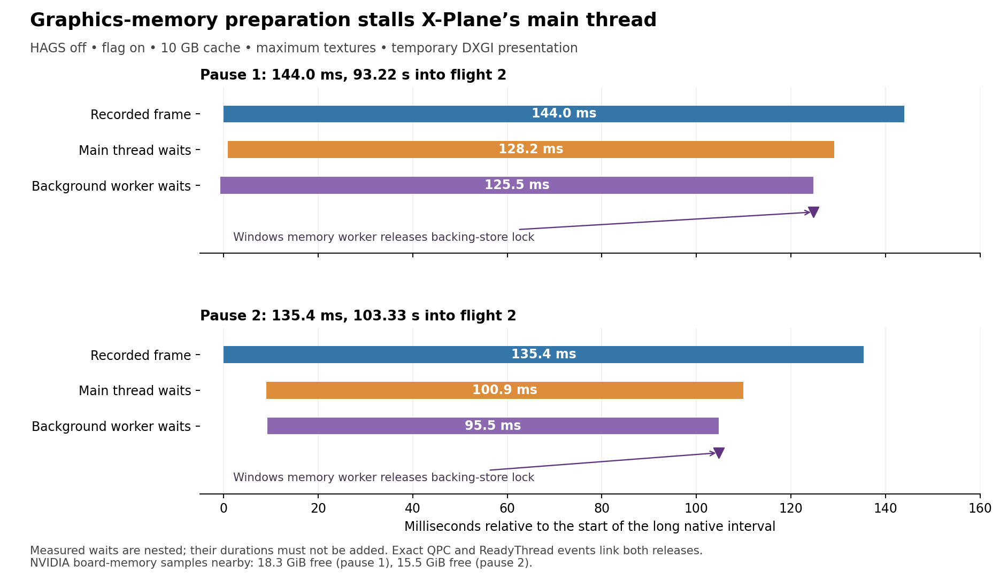

# Remaining stutters: graphics-memory preparation blocks the render path

The two largest captured pauses have a directly observed blocking chain. X-Plane's main thread waited on an exclusive lock inside NVIDIA's user-mode driver. The X-Plane background worker that released that lock was itself blocked inside Windows graphics-memory allocation. Windows' graphics-memory worker released the backing-memory lock, the background worker resumed and released the NVIDIA lock, and the main thread resumed immediately afterward.

This happened with **HAGS off, `--gfx_no_defragment` on, 10 GB disk texture cache, maximum textures and the same temporary DXGI presentation setting as the six-flight comparison**. The flag remains enabled in the saved configuration.

## Measured pauses

| Measure | Largest pause | Second-largest pause |
|---|---:|---:|
| Native callback interval | 143.9536 ms | 135.3947 ms |
| Time after second-flight unpause | 93.2208 s | 103.3336 s |
| Main thread blocked in NVIDIA exclusive-lock acquisition | 128.2195 ms | 100.9396 ms |
| Background worker's principal Windows allocation-lock wait | 125.4821 ms | 95.4708 ms |
| Background worker's following GPU-address mapping wait | 3.3097 ms | 4.1515 ms |
| Main thread ready-to-running delay | 0.0071 ms | 0.0107 ms |
| Nearby free NVIDIA board memory | 18.344 GiB | 15.463 GiB |
| Memory sample receipt after pause end | 14.6344 ms | 138.3010 ms |

These waits overlap and must not be added. The first background wait starts slightly before the measured native interval. Tiny ready-to-running delays show that CPU scheduling delay after the wakeup did not account for the long main-thread waits.

## Exact thread and stack chain

Target process: X-Plane PID **4844**. Main thread: **1652**, named `X-Plane-11`. Background thread: **25384**, named `Pool worker (background - 18)`. Windows graphics-memory worker: System PID **4**, TID **1936**.

1. The main thread enters `nvoglv64.dll`, then `RtlAcquireSRWLockExclusive` → `RtlpAcquireSRWLockExclusiveContended` → `NtWaitForAlertByThreadId`. It waits 128.22 ms / 100.94 ms.
2. Background worker 25384 calls into `nvoglv64.dll` to create a graphics allocation. Its stack reaches `NtGdiDdDDICreateAllocation` → `DxgkCreateAllocation` → `VidMmOpenAllocation` → `VIDMM_GLOBAL::CommitLocalBackingStore` → `VIDMM_RECYCLE_HEAP_MGR::Allocate` → `DXGAUTOMUTEX::Acquire` → `ExAcquirePushLockExclusiveEx` → `KeWaitForSingleObject`.
3. A `ReadyThread` event identifies System thread 1936 as the exact waker of worker 25384. Its stack contains `VidMmWorkerThreadProc` → `PageInOneAllocation` → `PageInAllocation` → `CommitResources` → `VIDMM_SYSMEM_SEGMENT::CommitResource` → `LockAllocationBackingStore` → `LockHeapAllocation` → `ExReleasePushLockExclusiveEx`. The background worker resumes 0.0137 ms / 0.0097 ms after being readied.
4. The background worker then encounters a short wait in `VidMmMapGpuVirtualAddress` / `CVirtualAddressAllocator::MapVirtualAddressRange`, resumes, and releases its NVIDIA exclusive lock through `RtlReleaseSRWLockExclusive`.
5. A second exact `ReadyThread` event links that release by worker 25384 to main thread 1652. The main thread resumes 0.0071 ms / 0.0107 ms later.

The evidence identifies graphics allocation and backing-memory preparation. It does **not** identify the exact allocation, texture, scenery tile, or owner of the resource being processed by the System worker. Private NVIDIA and X-Plane function names are unavailable; their module-relative addresses remain in the evidence. Do not turn these waits into a claim that a particular add-on or texture is at fault.

## GPU and memory corroboration

For the associated X-Plane GPU frames near the two pauses, PresentMon reports:

| Metric | Largest-pause cluster | Second-largest cluster |
|---|---:|---:|
| GPU frame span | 159.1169 ms | 170.9545 ms |
| Active GPU work | 12.6423 ms | 12.7766 ms |
| GPU wait | 146.4746 ms | 158.1779 ms |
| Following gap between presents | 145.6487 ms | 136.6220 ms |

These are associated presentation/GPU frames, not the same interval definition as the native callback measurement. The CPU and GPU operate asynchronously. The recorded columns are `MsGPUTime`, `MsGPUBusy`, `MsGPUWait` and `MsBetweenPresents`; GPU timing is anchored by `CPUStartQPC`, while `TimeInQPC` is the presentation timestamp in this output. GPU wait describes gaps in the target process's GPU work and does not establish that every engine on the entire GPU was idle. Metric definitions: [PresentMon 2.5.1 console documentation](https://github.com/GameTechDev/PresentMon/blob/v2.5.1/README-ConsoleApplication.md).

The nearby board-memory samples show 18,784 MiB and 15,834 MiB free, respectively, on the 32,607 MiB board. Minimum free memory across the sampled run was 10,954 MiB. These readings do not support physical VRAM exhaustion as the explanation for these pauses. They are 500 ms board-wide samples with receipt timestamps, not X-Plane residency, allocation identity or its Windows memory budget. Preparing, mapping and locking memory can stall while substantial VRAM remains free. The first large pause had no recorded hard faults in its exact interval; the second had system-wide hard-fault activity, which has not been assigned as the cause of the observed lock waits.

## A different shorter pause

The third selected pause was **85.1008 ms**, at 99.0429 seconds after unpause. The main thread was off CPU for only **0.8464 ms** within that interval. Its sampled stacks repeatedly call `SwitchToThread` / `NtDelayExecution` and `RtlQueryPerformanceCounter` through X-Plane RVAs `0x10ac556` / `0x10ac561` and common callers. This supports active polling/yielding, rather than the long exclusive-lock wait seen in the two largest cases. Windows graphics-memory work occurs concurrently, but the exact condition being polled is unknown; this overlap alone does not establish the same direct causal chain. The 18 captured pauses are not all assigned one cause.

## Capture integrity and current state

Run: `XPT_HAGSOFF_WPR_20260915`. Both flights passed timing validity; the first landing passed and the second missed touchdown speed, separately from timing validity. The fixed WPR observer recorded native-clock seconds 100–150 of the second flight. The accepted interval starts ten seconds after WPR acknowledgement and ends at the stop request: QPC **40207883927–40593512458**, frequency **10,000,000 Hz**, with **38.5580429 seconds** of complete native intervals. It contains **18 intervals >50 ms**, maximum **143.9536 ms**. Do not pool these traced counts with the untraced HAGS comparison.

Kernel CPU samples, context switches, ready-thread events and stacks cover the whole accepted interval; reported events lost = **0**. PresentMon decoded **2,081 accepted DXGI Composed: Flip presentations**. Public symbols were resolved afresh for **12 Windows modules** and verified against this trace's image size/checksum/timestamp and the local binary/PDB hashes. Old Windows symbol mappings were not reused after the update.

Windows remained **26200.9445**, NVIDIA **616.92**, HAGS off. The existing harness checks passed before capture, and no harness/native source was edited during the flights. System-tracing overhead is not fully calibrated; this is diagnosis of captured events, supported by the same late-flight pattern in the preceding untraced runs, not a measurement of the natural stutter rate.

Restoration passed at **2026-09-15 01:14:33 UTC**. Original NVIDIA profile settings and override absence match exactly. All three persistent preference hashes match: the flag, 10 GB cache and maximum textures are preserved. HAGS remains off. The simulator, observers and owned tracing host have stopped; the reusable tracing task is Ready. No additional settings change, reboot, upload or message was performed.

The practical target for subsequent mitigation tests is the graphics resource-allocation/backing-memory path. Reducing texture detail remains a candidate for reducing the workload, based on the earlier diagnostic, but neither this trace nor free VRAM proves that a particular texture setting will eliminate the pauses.

## Evidence

[58 retained artifacts and hashes](hags-trace-evidence/manifest.json) include native CSVs, decoded PresentMon data, three compressed event/stack extracts, fresh symbol resolution/verification, analysis scripts, the figure, run configuration and restoration audit. The full **1,799,356,416-byte ETL** remains at `D:\X-Plane 12\Output\performance-tests\XPT_HAGSOFF_WPR_20260915\segments\calm-02-diagnostic\system.etl`, SHA256 `c2c710fc710573daf3d613d6a9d465eb3e11dd3ca97c9a9d558e7e4afc266ddb`. Analysis scratch files are in `V:\src\xplane\build\stutter-hags-20260915\trace`.
