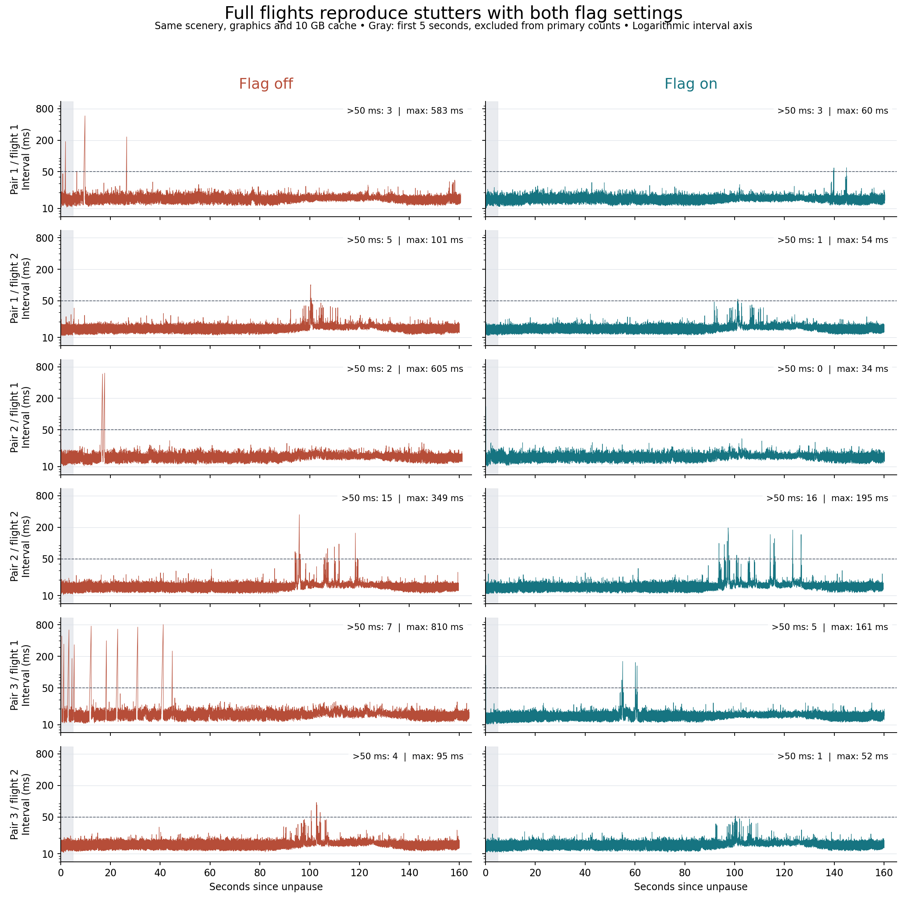

# Full-flight stutter comparison — September 14, 2026

Newest mitigation test: [Repeated texture-quality comparison](TEXTURE-RESULTS.md) completed twelve valid timing flights across six processes, with the flag on and HAGS off throughout. Maximum textures produced 21 intervals over 50 ms; one notch lower produced none. Worst intervals were 194 ms versus 40 ms, and all three pairs favored lower textures. Maximum quality was restored afterward. Two excluded startups and two post-flight recovery retries remain documented.

Newest diagnosis: [The HAGS-off system trace](HAGS-TRACE.md) reproduced 144 ms and 135 ms pauses and identified a two-stage blocking chain: Windows graphics-memory preparation blocks an X-Plane allocation worker, whose NVIDIA driver lock blocks the main thread. Exact wakeup events connect both stages. Nearby samples had 18.3 / 15.5 GiB VRAM free. The flag remains enabled; all temporary changes and tracing processes are restored/stopped.

Latest update: [Six post-reboot HAGS-off flights](HAGS-RESULTS.md), with the flag held on, still produced 15 intervals over 50 ms and a 174.61 ms worst pause. The rate was lower than the small pre-reboot DXGI diagnostic, but the worst pause was longer; variation and the simultaneous Windows update prevent attributing a consistent benefit to HAGS. The flag/cache/maximum texture settings are preserved. HAGS remains off; temporary NVIDIA and simulator changes are restored.

Earlier update: [Presentation-path investigation](PRESENTATION.md) tested NVIDIA's DXGI presentation method at maximum quality. It changed the measured presentation mode but did not eliminate the pauses. NVIDIA overlay and game filters were already off. The [HAGS test plan](HAGS-TEST.md) retains its original preparation history.

Subsequent update: [WPR/VRAM diagnosis and reusable tracing](WPR-VRAM.md) installed a protected on-demand tracing task, validated complete kernel trace coverage, and identified graphics-memory preparation blocking presentation with substantial VRAM free. A matched lower-texture diagnostic reduced accepted-window pauses from 18 to 2 but did not eliminate them. This supersedes the earlier elevation blocker; the earlier untraced measurements retain their original limits.

The longer test reproduced the problem. All twelve complete flights passed timing-integrity checks, and all three flag-off simulator launches produced pauses over 50 ms. With `--gfx_no_defragment`, the observed rate of these pauses was about **27% lower**, and the maximum interval fell from **810 to 195 ms**. The flag did **not** eliminate stuttering: five of six flag-enabled flights still had pauses over 50 ms.

These are native after-physics callback intervals, not display-present or VR-compositor timings. The [completed six-flight flag-on diagnostic](DIAGNOSTIC.md) captured a 53 ms update/render stall overlapping texture uploads and tested texture detail 5/4/5. Maximum-detail second flights paused at 53 and 73 ms; the lower-detail pair stayed below 50 ms. Rendering/texture synchronization is the leading hypothesis, with lower detail a promising but limited mitigation. Original maximum quality is restored. Windows again canceled the system-tracing prompt, so the exact underlying wait remains unresolved.

## Matched results

| Primary in-flight measure | Flag off | Flag on |
|---|---:|---:|
| Complete flights / fresh processes | 6 / 3 | 6 / 3 |
| Measured exposure | 15.60 min | 15.50 min |
| Intervals >25 ms | 215 | 200 |
| Intervals >50 ms | 36 | 26 |
| Intervals >50 ms per minute | 2.308 | 1.677 |
| Intervals >100 ms | 14 | 11 |
| Maximum interval | 809.90 ms | 195.48 ms |
| Flights containing >50 ms intervals | 6 of 6 | 5 of 6 |
| Pooled mean callback interval | 15.728 ms | 15.464 ms |
| Per-flight p99 range | 21.727–22.875 ms | 20.897–22.470 ms |
| Per-flight p99.9 range | 25.553–58.726 ms | 26.198–61.677 ms |
| Local outliers under the predeclared definition | 89 | 105 |

The flag reduced the observed >50 ms rate in each pair, but the second pair's difference was small. Counts of smaller local irregularities and the p99.9 ranges do not support a uniform improvement in every measure. Three process pairs are too few to infer a precise general effect or treat rare-event maxima as stable limits. Frames are not independent experimental replicates.

| Pair and launch order | >50 ms off / on | On-minus-off rate per minute | Maximum off / on |
|---|---:|---:|---:|
| 1: off, on | 8 / 4 | -0.771 | 583 / 60 ms |
| 2: on, off | 17 / 16 | -0.182 | 605 / 195 ms |
| 3: off, on | 11 / 6 | -0.941 | 810 / 161 ms |

The gray first five seconds are retained activation evidence and excluded from the primary counts. The chart includes them for transparency. Raw callback intervals use a logarithmic vertical axis. [SVG](flight-timelines.svg), [all flight statistics](per-flight.csv), [machine-readable comparison](comparison.json), [full run table](COMPARISON.md).

## What the short test missed

The prior twenty-second parked test supplied no stutter-reproduction baseline. This campaign used the complete approximately 160-second moving maneuver, two fresh flight loads in each of six fresh simulator processes, in AB/BA/AB order. The predeclared reproduction rule required event-bearing baseline flights across at least two fresh processes; this campaign exceeded it.

The most severe flag-off pauses occurred in the first flight after startup. Examples include 583 ms at 9.20 seconds, 582/605 ms at 16.24/17.08 seconds, and seven intervals above 100 ms from 5.15 to 44.59 seconds in the final baseline launch. These occurred after the fixed activation exclusion.

Later clusters remained after flight reloads under both settings. The strongest flag-enabled repeat had sixteen intervals above 50 ms from 93.62 to 126.55 seconds, including 195 ms at 97.22 seconds. The separate native flight-controller trace agrees with these durations within about six microseconds when aligned by monotonic elapsed time. The aircraft was airborne during the turn to base, base leg and turn to final. The two recorders' simulation-time origins differ; comparing their raw `sim_time` values would produce an incorrect alignment.

Other flag-enabled events occurred near 140–145 seconds in one first flight and 55–61 seconds in another. The remaining problem therefore cannot be reduced to one fixed instant. The timing pattern by first/second flight is descriptive exploration, not an independently randomized causal test.

## Controls and validity

X-Plane 12.4.4 beta 1, build 124410; TorqueSim SR20; KCDW runway 22; full tanks and 200 lb in each front seat; calm weather; unchanged native guidance, buffered controller 0.8.5 and passive performance recorder 0.1.0. All trials retained the user's enabled scenery, maximum texture detail, other graphics preferences and 10 GB cache. Temporary conditions were foreground 2D, fixed cockpit view, no sound/physical joystick input and TelemFFB-XPP isolation. Other global plugins were retained; retained readiness records distinguish loaded plugins from installed files.

Every measured flight had uninterrupted unpaused exposure bracketed by paused samples, complete native buffers, consistent QPC deltas, actual foreground 2D and valid continuous controller authority. No video, in-flight screenshots, Microprofile dumps or WPR captures were used in this comparison. Both timing recorders buffered data and exported after each flight. The first five seconds and the callback crossing unpause are retained separately. Details and thresholds were declared before the campaign in [METHOD.md](METHOD.md).

All six launch argument lists, actual post-run preferences and identical harness/source hashes were verified in the [configuration audit](configuration-audit.json). The cache was neither cleared nor varied; these data make no new claim about cache capacity or load-time benefit. The full session and restoration overhead made the six-process campaign take about 72 minutes; the accepted primary flight exposure was about 31 minutes total.

Timing validity and landing precision remain separate. All six first flights passed the landing limits. All six second flights missed the touchdown-speed limit; their misses remain in the assessments, and no acceptance limit or guidance was changed to hide them. The timing data remained valid. This campaign does not establish VR behavior or general landing repeatability.

## Windows trace coverage finding and pending diagnosis

An offline audit of the earlier `XPT_PERF_LIVE_05_20260914/segments/01_buffered/system.etl` found that its 512 MiB system buffer wrapped. The ETL spans 41.97 seconds, but CPU sampling and context-switch events begin about 32.86 seconds after capture start. Only approximately the last 7.60 seconds of its 20-second measured window had context-switch coverage. `EventsLost` was zero, so that counter alone did not reveal the missing earlier window. The previously verified presentation-event coverage is a separate fact; the old ETL cannot support full-window CPU attribution. See [event coverage](earlier-trace-coverage.json).

The retained interval contains roughly 1.6 million logical database reads from iCloud Drive, approximately 6.58 GB, which dominated file-event volume. Logical reads are not proof of physical-disk traffic. This explains the trace-buffer pressure, not the cause of the current flight stutters: that earlier parked run itself had no >50 ms presentation pauses. No iCloud settings or processes were changed. See [file activity](earlier-trace-file-activity.json).

The offline reader uses Microsoft's [TraceEvent library](https://github.com/microsoft/perfview/blob/main/documentation/TraceEvent/TraceEventProgrammersGuide.md), [NuGet version 3.2.6](https://www.nuget.org/packages/Microsoft.Diagnostics.Tracing.TraceEvent/3.2.6). Package SHA256: `e4dd62e649642130145fa6e07f75a73ceb9c617b739b96455fb60b7cac89ed20` (case-insensitive). Offline probe source and package remain under `V:/src/xplane/build/stutter-etl-analysis`.

A larger 4 GiB system buffer and a separate bounded flight observer are prepared. The machine had 41.68 GiB free RAM with X-Plane closed. The observer targets the second-flight sequence, uses the existing read-only status endpoint, keeps guidance/heartbeats independent, and records QPC timestamps around WPR start and stop. The first ten seconds after trace-start acknowledgement and all events after the stop request are excluded from causal interpretation. The larger profile still requires a live coverage check; it is not yet validated. The proposed diagnostic must remain separate from this A/B sample.

Windows canceled both the initial administrator prompt and the explicitly requested retry for the restricted WPR helper. No new privileged host or WPR trace started. The subsequent [non-administrator Microprofile diagnosis and texture experiment](DIAGNOSTIC.md) are complete. Verified CPU/scheduling coverage is still required to identify the underlying wait, and the larger WPR profile remains unvalidated.

## Verification and restoration

35 Python tests, Rust workspace/release checks, PowerShell parsing, exact-process identity checks, atomic-record checks and whitespace checks passed. The new observer also passed Python compilation and argument parsing. The [diagnostic test log](diagnostic-tests.log) and [recovery probe](diagnostic-recovery.json) are retained.

All six comparison sessions restored 122 preference files, 11 SR20 state files, 179 scenery entries, five links, isolated TelemFFB files and original aircraft/plugin hashes. Temporary helpers were removed. Comparison restoration finished at 13:47:11 EDT; the later deliberate worker-handoff failure probe restored at 13:54:35 EDT. The [settings audit](settings-verification.json) verifies the approved xOrganizer defaults and active preferences; the [process audit](final-process-audit.json) confirms no simulator, test worker or owned WPR host remains.

The initial matrix attempt `XPT_FULL_FLIGHT_AB_20260914` failed before measurement because the new integration requested a missing cockpit command. It was corrected to the existing verified `sim/view/3d_cockpit_cmnd_look`; that failure and its successful restoration remain separate from the accepted replacement matrix `XPT_FULL_FLIGHT_AB02_20260914`. Deliberate recovery probes are recovery evidence, not flown performance passes. [Nine retained attempts](attempts.json), [work log](WORKLOG.md).

Compressed raw timing/controller traces and per-card assessments are retained under [evidence](evidence). Full original logs and transaction records remain under `D:/X-Plane 12/Output/performance-tests`, using the run names in the comparison. [build_report.py](build_report.py) rebuilds the chart, compressed evidence and configuration audit without launching the simulator.
