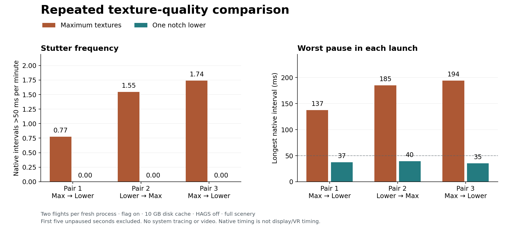

# One notch lower textures consistently reduced the reproduced stutter

With `--gfx_no_defragment` enabled, the 10 GB disk texture cache and HAGS off, maximum textures produced **21 native intervals over 50 ms** across six flights. One notch lower produced **none** across six matched flights. Each setting had three fresh simulator processes and about 15.5 minutes of accepted exposure. The largest interval fell from **194.16 ms to 39.50 ms**.

Lower textures favored the primary metric in **all three pairs**, including the reversed-order pair. This supports one notch lower as a practical mitigation for this repeated-flight 2D workload. Zero observed pauses over 50 ms is not a guarantee for longer flights, other scenery, or VR. Earlier traced lower-texture testing still captured a long pause; its diagnostic counts are not pooled here.

## Measurements

| Measure | Maximum textures (5) | One notch lower (4) |
|---|---:|---:|
| Valid timing flights / fresh processes | 6 / 3 | 6 / 3 |
| Accepted exposure | 930.892 s | 932.236 s |
| Intervals >25 ms | 218 | 96 |
| Intervals >25 ms per minute | 14.05 | 6.18 |
| Intervals >50 ms | 21 | 0 |
| Intervals >50 ms per minute | 1.354 | 0 |
| Intervals >100 ms | 11 | 0 |
| Worst interval | 194.157 ms | 39.502 ms |
| Processes containing an interval >50 ms | 3 of 3 | 0 of 3 |

The >25 ms rate was about **56% lower overall**. Most improvement occurred on the second flight: every maximum-texture second flight stuttered, with 4, 8 and 9 intervals over 50 ms; every lower-texture second flight stayed below 50 ms. The second-flight >50 ms rate was 2.711/min at maximum and zero observed one notch lower. First flights stayed below 50 ms at both settings. Their smaller-delay rates were similar, so this is not a uniform improvement in every timing measure.

| Pair and execution order | Maximum: >50 ms / worst | Lower: >50 ms / worst |
|---|---:|---:|
| 1: maximum, then lower | 4 / 137.35 ms | 0 / 37.30 ms |
| 2: lower, then maximum | 8 / 185.13 ms | 0 / 39.50 ms |
| 3: maximum, then lower | 9 / 194.16 ms | 0 / 35.37 ms |

The [individual-flight table](texture-repeat-evidence/analysis/flight-table.md) retains exposures and p99.9 values. The [results JSON](texture-repeat-evidence/analysis/results.json) retains full-flight and activation statistics, recorded hitches, paired rates, source checks and errors.

## Controls and validation

X-Plane 12.4.4 beta 1; TorqueSim SR20; the existing calm KCDW runway 22 power-off 180 card, two flights per process, full tanks and 200 lb in each front seat. All enabled custom scenery was retained. TelemFFB-XPP was temporarily isolated through the existing transaction on both settings. The saved rendering profile was used with VR temporarily disabled for the authorized 2D test.

Windows stayed at **26200.9445**, NVIDIA at **616.92**, and the system remained on the same boot with HAGS off (`HwSchMode=1`). The NVIDIA application profile remained exactly unchanged, with **no temporary DXGI presentation override**. The flag and 10 GB cache were verified in every session. Only texture quality differed between accepted test settings: internal `_tex_res` 5 versus 4, with the corresponding UI preference.

The harness checks passed before flying. Source/configuration manifests match across all six accepted processes; no harness or native guidance source changed during the campaign. All twelve flights passed continuous foreground, actual 2D, control-authority, uninterrupted exposure, monotonic QPC and complete-buffer checks. All accepted flights used ordinary startup with zero recorded menu-recovery attempts and no external startup intervention. Counts and exposures were independently recounted from the native CSVs. Accepted logs contain no fatal-alert, crash or Safe Mode marker under the retained audit search.

The primary window excludes the first five unpaused seconds. This is **native after-physics callback timing**, not monitor presentation or VR-compositor timing. No WPR, PresentMon capture, GPU observer, Microprofile request, video or screenshot ran during measured flights. The native recorder buffered rows until the maneuver ended.

Landing acceptance is separate: all six first-flight landings passed; all six second-flight landings missed touchdown speed. Those misses remain in the assessments and are not promoted to landing passes because timing was valid.

## Failed startups and recovery

Two attempts for the second lower-texture process produced **no measured flights** and were excluded:

- `XPT_TEXTURE_REPEAT_03_T4_20260915` remained in startup at the flight configuration/main menu. UI resume attempts did not complete initialization. Cancellation was requested, then the existing exact-process recovery routine restored the installation.
- `XPT_TEXTURE_REPEAT_03R1_T4_20260915` also could not unpause initialization. Menu recovery encountered X-Plane's fatal aircraft-preview error, “No liveries for aircraft”. Its fatal log and failed attempt are retained.

Replacement `XPT_TEXTURE_REPEAT_03R2_T4_20260915` started normally and supplied two valid timing flights. Its post-flight recovery, and that of `XPT_TEXTURE_REPEAT_05_T5_20260915`, initially refused file moves while X-Plane was still exiting. The existing recovery entry point succeeded after the process exited. Their original recovery errors and `complete:false` runner results remain intact. They are valid individual timing records with verified restoration, not clean runner passes.

The original plan, amendments, wrapper logs, excluded attempts and recovery audits are retained. No flight was discarded based on its stutter count, and all six planned valid processes were completed. This was not an error-free harness campaign.

## Interpretation and final state

This provides stronger mitigation evidence than the earlier single traced texture pair: maximum textures reproduced the baseline in all three processes, the lower setting stayed below 50 ms in all three, and reversing the order did not reverse the result. There are still only **three independent launches per setting**; individual frames are not independent experimental replicates. Disk and OS caches evolved throughout. This is not a cold-cache experiment or proof of the natural stutter rate in long flights or VR.

The test supports a texture-quality trade-off to reduce the reproduced pauses. It does not establish physical VRAM exhaustion or identify the allocation responsible for the [previously traced graphics-memory waits](HAGS-TRACE.md).

**Maximum texture quality was restored after testing.** The saved xOrganizer flag, active/default 10 GB cache preferences and original VR preferences match all three pre-test file hashes. The NVIDIA profile is unchanged. HAGS remains off. All eight attempted sessions have verified restoration, including the excluded startups; their 24 recorded owner/worker/simulator identities are stopped. The tracing task is idle. See the [final audit](texture-repeat-evidence/analysis/final-audit.json).

The [evidence manifest](texture-repeat-evidence/manifest.json) records artifact hashes, compressed native CSVs, original paths, configuration and restoration records. Raw runs remain under `D:\X-Plane 12\Output\performance-tests`. Reproduction and analysis scripts are retained in `V:\src\xplane\build\stutter-textures-20260915` and copied into the evidence bundle.
