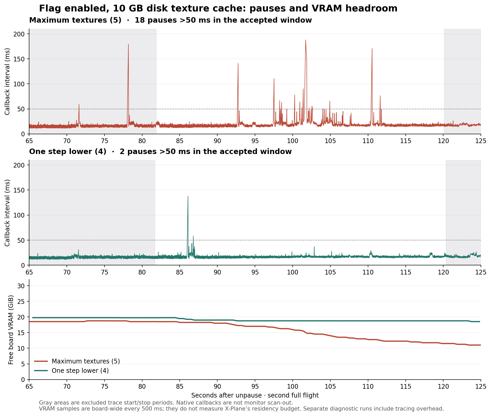

# Flag-on stutters: graphics memory waits and reusable tracing

The approved tracing helper now starts from a restricted, on-demand Windows scheduled task. Two unelevated starts and an intervening stop succeeded without another UAC prompt; a third start launched the texture comparison. The fixed scripts/profile are protected under `C:/Program Files/CodexXPlaneTracing`. The normal desktop account can run the task and read its files, but cannot modify them. The task uses the existing interactive token, stores no password and has no automatic trigger. Changes to its protected code or profile still require administrator approval. See [installation audit](installed-tracing-task.json).

## What the trace establishes

With the no-defragment flag, 10 GB disk texture cache, maximum textures and full scenery, four large native frame intervals contain long waits in Windows' graphics memory manager. X-Plane is attempting to submit a presentation. Its main thread waits for the memory manager to release a lock while preparing allocation backing pages. These events occurred with substantial physical VRAM free.

| Second flight, seconds after unpause | Native callback interval | Main-thread lock wait | Ready to running |
| --- | ---: | ---: | ---: |
| 92.616 | 140.867 ms | 118.467 ms | 0.0135 ms |
| 101.534 | 187.896 ms | 147.828 ms | 0.0096 ms |
| 101.722 | 145.156 ms | 100.439 ms | 0.0093 ms |
| 110.377 | 170.685 ms | 146.038 ms | 0.0098 ms |

The main thread is TID 76064 (`X-Plane-11`) in PID 36844. Its suspended stack follows:

```text
dxgkrnl!DxgkSubmitPresentToHwQueue
  DXGCONTEXT::Present / SubmitPresent / SubmitPresentWithDmaBuffer
dxgmms2!VIDMM_GLOBAL::ReferenceDmaBuffer
  VIDMM_RECYCLE_HEAP_MGR::GetFullMDL
  DXGAUTOMUTEX::Acquire
ntoskrnl!ExAcquirePushLockExclusiveEx
  KeWaitForSingleObject
```

The exact ReadyThread events identify System TID 52112 releasing the lock and waking X-Plane. Their stacks follow `VidMmWorkerThreadProc → PageInOneAllocation → PageInAllocation → VIDMM_SYSMEM_SEGMENT::CommitResource → LockAllocationBackingStore → LockHeapAllocation → ExReleasePushLockExclusiveEx`. Nearby worker samples also show `MmProbeAndLockPages` and page-table work. The wait reason is `WrPushLock` (28), independently documented by [Microsoft's kernel wait enumeration](https://learn.microsoft.com/en-us/dotnet/api/microsoft.windows.eventtracing.cpu.kernelwaitreason?view=trace-processor-dotnet-1.0).

This identifies the immediate blocking mechanism in these four traced pauses. It does not identify the particular allocation owner or texture, prove a driver bug, or prove every earlier stutter has this cause. The earlier Microprofile render-stage/upload overlap remains separate evidence. No private X-Plane or NVIDIA function names were inferred from raw addresses.

## VRAM interpretation

The RTX 5090 reports 32,607 MiB total frame-buffer memory. During the maximum-texture second flight, board-wide use ranged from 12,985 to 21,963 MiB, leaving at least 10,225 MiB free (about 10.0 GiB). The nearest sample to the longest pause reported 17,081 MiB used and 15,107 MiB free (about 14.8 GiB free), with a receipt timestamp 194 ms after the native interval ended.

These measurements argue against the card simply being full. They do not exclude a per-process residency/budget issue or a brief event between samples. NVIDIA's counters are board-wide, include other programs, and were sampled every 500 ms; the receipt QPC is not an exact query timestamp. [NVIDIA documents the memory counters and WDDM limitations](https://docs.nvidia.com/deploy/nvidia-smi/index.html). Windows manages resource residency and GPU virtual addresses backed by either local or system memory, so graphics-memory work is not synonymous with exhausting physical VRAM. See [Microsoft's residency model](https://learn.microsoft.com/en-us/windows-hardware/drivers/display/driver-residency-in-wddm-2-0) and [GPU virtual memory model](https://learn.microsoft.com/en-us/windows-hardware/drivers/display/gpummu-model).

Lower textures may reduce preparation and transfer demand even with free VRAM. The 10 GB texture cache is disk storage, not an extra 10 GB reserved on the graphics card. Large logical reads from that cache overlap the busy period, but the demonstrated main-thread delay is the graphics-memory lock; this trace does not establish the cache or disk as the root cause.

## Matched texture comparison

Both runs used the same harness sources, flag, 10 GB cache, scenery, aircraft, two-flight sequence and WPR profile. Each completed two timing-valid flights and verified restoration. The accepted second-flight windows exclude trace startup and export:

| Texture setting | Accepted exposure | Native intervals >50 ms | Longest interval | Lowest free VRAM over second flight |
| --- | ---: | ---: | ---: | ---: |
| Maximum (5) | 38.212 s | 18 | 187.896 ms | 10.0 GiB |
| One step lower (4) | 38.657 s | 2 | 137.961 ms | 18.5 GiB |



The lower setting reduced the observed count substantially in this pair, but did not cure the problem. Its 137.961 ms pause at 85.960 seconds contains a 118.698 ms `GetFullMDL` push-lock wait, released by the same System memory-manager thread. The nearest memory sample reports 19,695 MiB (19.2 GiB) free. The second 58.156 ms pause contains a 32.292 ms `WrAlertByThreadId` wait in a user-mode NVIDIA driver call, awakened by another X-Plane process thread. Private NVIDIA symbols are unavailable, so the specific driver job is not identified.

The lower-texture first flight had no intervals over 50 ms and a 37.580 ms maximum. As in the maximum run, its first landing passed and its second missed the touchdown-speed criterion. Both traces retained the complete accepted CPU/scheduling window with zero reported loss, and both decoded successfully with PresentMon.

Together with the earlier untraced 5/4/5 diagnostic, this makes one step lower a plausible mitigation with a texture-detail tradeoff. It is not a measured universal percentage improvement: there is only one newly traced process per setting, cache contents remain warm, and tracing overhead is uncalibrated. Maximum texture quality was restored after the tests; the requested flag and 10 GB cache remain configured. No larger-VRAM purchase is justified by this evidence. A complete fix for the demonstrated Windows/driver memory-management wait remains unverified.

## Measurement quality and limits

The maximum-texture run completed two timing-valid full flights. The first had zero intervals over 50 ms and a 36.363 ms maximum. The second contained 18 intervals over 50 ms inside the accepted diagnostic window, with a 187.896 ms maximum. The first landing passed precision criteria; the second missed the touchdown-speed criterion, which remains recorded.

The accepted QPC interval is 6058950540531–6059332857872 at 10 MHz. It begins ten seconds after WPR start acknowledgement and ends before the stop request. Startup and export periods are excluded. Both `PerfInfo/Sample` and `Thread/CSwitch` cover the entire accepted interval, and WPR/TraceEvent report zero event loss. The 4 GiB system buffer fixed the earlier trace-retention problem for this capture; that is not a guarantee for longer or busier captures. The saved ETL is 3,305,111,552 bytes. PresentMon successfully recovered presentations; the largest adjacent present gaps in the inspected cluster were 196.989 and 134.681 ms. These are distinct from the native callback intervals, and neither is a claim of VR display timing.

Microsoft symbols were retrieved by matching PDB identity from the local binary. All eight symbolized binaries match the trace image size and checksum; five also carry matching timestamps, while three trace records lack a timestamp. Symbol hashes and the exact relevant stacks are retained. The raw ETLs remain in their run directories and are referenced with hashes in `wpr-vram-results.json`.

Both diagnostic runs include WPR and read-only NVIDIA sampling. Their overhead has not been calibrated, so these counts must not be added to the earlier untraced A/B comparison or presented as normal-play stutter rates. Repeated lock evidence establishes a mechanism within the traced run, not its untraced frequency. Busy background iCloud database reads are visible but are not connected to the observed unlock chain. No causal attribution to iCloud is made.

## Reproduction

From `tools/flight-test-harness`, start the installed helper with `scripts/Start-InstalledWprHost.ps1`, allow its bounded CPU-privilege probe to complete, and ping the fresh nonce. Keep the simulator and test worker unelevated. Run the unchanged two-flight transaction with `-Mode Flight -TraceFlight -RenderingProfile User2D -KeepCustomScenery -VisibleSimulator -NoDefragment -TextureCacheGB 10 -IsolateGlobalPlugin TelemFFB-XPP`, using `configs/stutter-full-flight.json`. Maximum textures use the saved `_tex_res 5`; the comparison uses `-TextureResolution 4`. Start `scripts/Trace-FlightWindow.py --run <run>` and `scripts/Observe-GpuMemory.py --run <run>` as separate passive observers. Leave the simulator foreground during flight and do all ETL decoding/analysis after restoration.

Offline analysis uses pinned PresentMon 2.5.1 and Microsoft TraceEvent 3.2.6. The retained `Run-Probe.ps1` and `EtlHitchProbe.cs` reconstruct context switches, exact wakeups and relevant stacks. [Machine-readable results](wpr-vram-results.json) include the six inspected wait chains, exact QPC boundaries, symbolized frames, memory samples and evidence hashes. `collect_wpr_vram.py` audits settings, restoration, source equality, trace coverage, VRAM and those wait chains; `build_wpr_vram_plot.py` renders the standalone comparison.

Both helpers were stopped cleanly after their captures. The installed task remains available on demand. The [final audit](wpr-vram-final-audit.json) verifies the original maximum texture/VR preferences, the requested xOrganizer flag and cache, protected helper hashes, and stopped owned processes.
