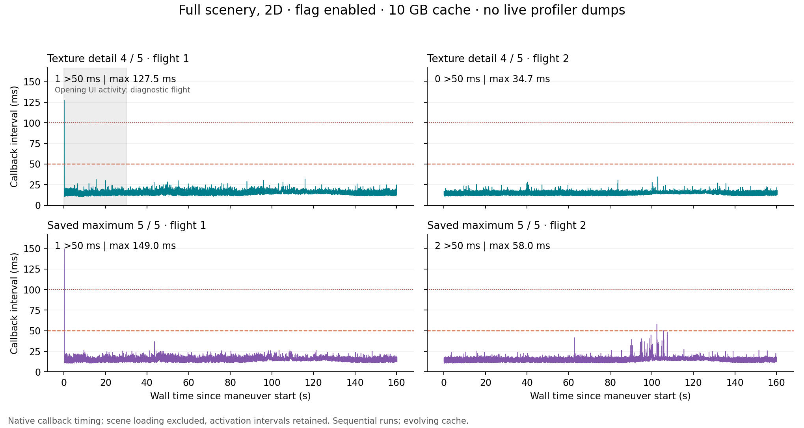

# Full-scenery stutter follow-up — September 14, 2026

The requested persistent settings are saved: xOrganizer's default launch arguments are `--open_xr --gfx_no_defragment`, and both the active X-Plane preference file and xOrganizer's default preference profile specify `_tex_cache_gb 10`. The original files and exact before/after hashes are retained in [settings-change.json](settings-change.json). The 10 GB setting is a disk texture cache, separate from texture detail and VRAM capacity.

This follow-up uses the user's full scenery arrangement and graphics detail in 2D. The [earlier reduced-profile study](../stutters-and-cache-20260913/README.md) found a clear benefit from the flag and about 17% faster repeat loading with 10 GB versus 5 GB. Those loading results remain specific to that study; this follow-up is not another controlled cache-capacity benchmark.

## What the trace establishes

The remaining pauses are not all eliminated by the defragmentation flag. In two hidden-window diagnostic flights, each had two native callback intervals above 50 ms (maxima 67.2 and 52.7 ms). Corresponding Microprofile captures contain main-thread `Swapchain present` scopes of 39.0 and 33.6 ms. A later capture also shows substantial main-thread render preparation and resource work.

In the uninterrupted foreground diagnostic flight, the first 77.3 ms callback hitch preceded its profiler request. Its captured main-thread frame spans 77.85 ms, including 53.21 ms in `Swapchain present` and 23.02 ms in `App Update`. The flight ultimately contained eight intervals above 50 ms, four above 100 ms, with a maximum of 161.2 ms. Subsequent intervals in that burst may have been affected by the profile dump, so they do not all independently establish normal flight behavior. The first visible flight also overlapped screenshot/focus activity and is explicitly marked diagnostic.

Texture upload/loading timers were active in the capture's aggregation window. These support investigating texture streaming, but do not prove a particular texture or upload caused the presentation wait. Aggregate timer maxima summarize the latest 60 frames; they must not be read as exact simultaneous scopes in the full 240-frame capture. GPU timer scopes were not available. The observed approximate GPU frame time and roughly 12 GB of allocated VRAM on a 32 GB card do not establish VRAM exhaustion. `Swapchain present` can include synchronization or scheduling waits, so this is not a diagnosis of a specific NVIDIA driver fault.

## Capture-free comparison and final outcome

**The flag and 10 GB cache remain saved; original maximum texture quality is retained. No additional stutter cure was verified.** The final maximum-detail repeat still had two mid-flight pauses of 50.17 and 58.03 ms, at 105.69 and 102.43 seconds respectively, plus smaller spikes during the turn. These occurred without profiler requests or UI interaction and therefore establish residual pauses under the requested settings. The earlier 100–161 ms mid-flight burst was not reproduced in these capture-free controls, but the sequential tests do not isolate profiler overhead as its cause.

| Texture detail | Flight | Median / p99 interval | Longest interval | >50 ms intervals | Timing context |
| --- | --- | --- | --- | --- | --- |
| One step lower (4/5) | 1 | 16.31 / 22.23 ms | 127.45 ms | 1 | Opening UI activity; diagnostic |
| One step lower (4/5) | 2 | 16.06 / 19.40 ms | 34.67 ms | 0 | No UI or profiler requests |
| Saved maximum (5/5) | 1 | 16.26 / 22.34 ms | 149.00 ms | 1 | No in-flight UI or profiler requests |
| Saved maximum (5/5) | 2 | 16.17 / 20.96 ms | 58.03 ms | 2 | No UI or profiler requests |

Each flight records approximately 160 seconds. The 127 and 149 ms intervals occur on the first positive native interval at test activation; they remain included in the table. The maximum-detail first flight had no later interval above 50 ms. These are monotonic callback intervals, not display-present timestamps.



Lower texture detail produced a smoother uninterrupted repeat, including fewer smaller outliers, but there is only one clean full-flight observation at that setting. A planned second lower-detail pair failed before either flight because the beta reported an aircraft-preview/livery error. That failure does not establish that texture detail caused the error. The potential quality tradeoff is therefore documented without applying it permanently. There is no measured VR result and no basis here for claiming all stutters are fixed.

Eight flown measurements retained continuous controller authority and consistent timing. Four passed the precision landing limits; each second flight missed the touchdown-speed limit (67.21–67.25 KIAS versus a 67 KIAS maximum). Those four remain failed landings.

## Test boundaries and retained failures

- X-Plane 12.4.4 beta 1, build 124410; Ryzen 9950X3D and RTX 5090; NVIDIA driver 616.92.
- TorqueSim SR20, KCDW runway 22, calm power-off 180, same full-fuel loading and native runtime 0.8.4 throughout. No guidance or aircraft physics changes in this follow-up.
- Full enabled Custom Scenery retained. Only TelemFFB-XPP is temporarily isolated to prevent competing control writes. Other plugin directories remain present, but FlyWithLua failed to load with Windows error 126. Consequently, its 3jFPS script was not active; these data do not implicate 3jFPS.
- The original 180-second scene-readiness window expired before a flight. The full-scene test path now allows 600 seconds while keeping the same position and flight-entry gates. The failure is preserved separately from flown measurements.
- The attempted VR session returned `XR_ERROR_SYSTEM_INVALID` and stayed in 2D. It was cancelled with zero flights after the user chose 2D testing. Its concurrent launcher/recovery errors are preserved; the official recovery completed successfully. There are no VR performance conclusions.
- The maximum-detail control completed both flights, then recovery encountered an active-process/identity check during shutdown. Once X-Plane had exited, rerunning the unchanged official recovery restored and verified the installation at 06:09:43 UTC. The error is preserved rather than described as an uninterrupted successful runner.
- The additional lower-texture confirmation stopped before flight after `Error generating path for aircraft preview` / `No liveries for aircraft` at `aircraft_grid_widget.cpp:565`. It was cancelled and restored through the official recovery procedure; its two planned flights are not counted.
- Timing validity and landing acceptance are separate. All precision landing failures remain failures; uninterrupted frame/control evidence does not convert them into passes.

See [method.md](method.md), [flights.csv](flights.csv), [profiler-evidence.json](profiler-evidence.json), and [audit.json](audit.json). The full native traces, captures, errors and restoration manifests remain in `D:/X-Plane 12/Output/performance-tests`. Raw diagnostic captures and setting backups are in `STUTTER_FOLLOWUP_20260914` beneath that directory.

## Reproduce the comparison

With X-Plane closed, run the official harness from `V:/src/xplane/tools/flight-test-harness`:

```powershell
.\Run-XPlaneTest.ps1 -Config '<retained calm requested-config.json>' `
  -Name '<fresh run name>' -NoDefragment -TextureCacheGB 10 `
  -RenderingProfile User2D -KeepCustomScenery -VisibleSimulator `
  -TextureResolution 4 -IsolateGlobalPlugin TelemFFB-XPP
```

Omit `-TextureResolution 4` to retain the saved maximum. Do not run a profiler observer or record/capture the screen during the comparison. Keep any unavoidable UI activity in the evidence. The harness records the exact argument and preference map and restores the complete original preference snapshot, including saved VR state and the newly persistent 10 GB cache.

The harness checks passed after adding the reversible texture override; the parser's tests cover cross-frame scopes, truncated scopes and rejecting executable capture expressions. Restoration checks compare all original preference and aircraft-state files, scenery entries/links/index, isolated plugin contents and temporary-helper removal. The final audit also checks consecutive native samples and matching monotonic interval/timestamp deltas.

The final audit passed: all eight sessions have verified restoration, all eight flown traces have consecutive native samples and consistent wall-clock deltas, and all three persistent settings files match their recorded post-change hashes. X-Plane is closed. The active preference's original VR-enable value and both profiles' original maximum texture detail are restored.

Laminar documents the beta's defragmentation workaround in the [12.4.4 release notes](https://www.x-plane.com/kb/x-plane-12-4-4-release-notes/) and repeat-loading purpose of the texture cache in [its SDK update announcement](https://www.x-plane.com/2026/09/whats-new-in-12-4-4-the-sdk-update/). Capture interpretation follows the [Microprofile project](https://github.com/jonasmr/microprofile). The requested forum discussion and other suggestions are covered in the [earlier forum notes](../stutters-and-cache-20260913/forum-notes.md).
