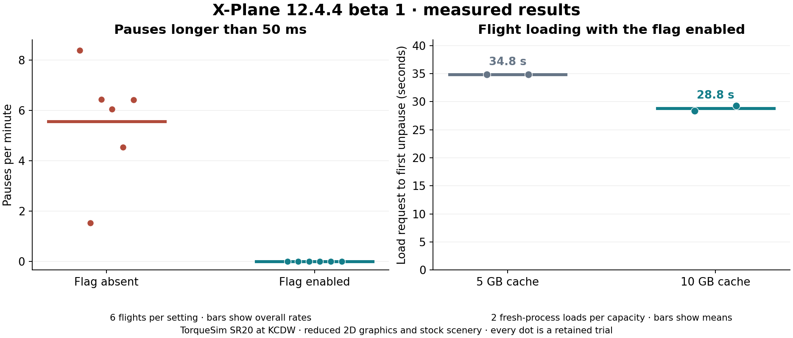

# X-Plane 12.4.4 beta 1: measured stutters and texture-cache loading

Tested September 13, 2026, local time (September 14 UTC), on Ryzen 9 9950X3D / GeForce RTX 5090 / NVIDIA 616.92.

**The flag eliminated the observed pauses above 50 ms. Increasing the texture cache from 5 GB to 10 GB reduced this scene's loading time by about 6 seconds, or 17%.** These are separate measured benefits. The practical recommendation for this beta is `--gfx_no_defragment` with a 10 GB texture cache. All original installation settings were restored after testing; this recommendation was not permanently applied.



## Stutters

Twelve complete TorqueSim SR20 power-off 180 landings at KCDW runway 22 all passed the existing landing and continuous-control-authority checks. The same instrumented controller binaries were used throughout. Six flights with the flag had **zero intervals above 50 ms**; six without it had **88**, including **50 above 100 ms**. The largest interval fell from **217.4 ms to 30.0 ms**.

| Flag | Cache | Flights / fresh processes | Measured minutes | Intervals >50 ms | Per minute | Maximum interval |
| --- | ---: | ---: | ---: | ---: | ---: | ---: |
| Absent | 5 GB | 2 / 1 | 5.26 | 26 | 4.94 | 200.8 ms |
| Enabled | 5 GB | 2 / 1 | 5.17 | 0 | 0 | 27.3 ms |
| Enabled | 0 GB | 4 / 2 | 10.62 | 0 | 0 | 30.0 ms |
| Absent | 0 GB | 4 / 2 | 10.59 | 62 | 5.86 | 217.4 ms |

The improvement is in occasional long pauses. Mean callback frequencies remained roughly 87–93 Hz across conditions; average FPS and p99 alone obscure these rare interruptions. The [per-flight CSV](flights.csv) includes exposure, p95/p99/p99.9, maxima and pause counts. The [timeline](hitch-timeline.png) shows every interval above 50 ms. Variation is retained: the two original baseline flights had 22 and 4 such intervals.

Runtime 0.8.4 adds a monotonic wall clock to the existing after-physics callback. This is simulator loop pacing, **not a display-present or VR-compositor measurement**. The older simulation timestep topped out near 50.25 ms even when an actual callback gap exceeded 200 ms. The underlying guidance, attitude thresholds and flare behavior were unchanged for this study. The earlier [landing repair](../../../poweroff180/timing-fix-20260911/README.md) remains separate from the graphics workaround.

## Texture-cache loading benefit

A focused comparison held the flag enabled and used fresh simulator processes in the order **5, 10, 10, 5 GB**. Each run stopped after the first successful unpause, before the landing maneuver. Loading was measured from the saved request immediately before POST `/flight` to the saved first successful-resume readback. This includes load/readiness checks and excludes the later mass/fuel preparation.

| Order | Cache | Load to first successful unpause |
| ---: | ---: | ---: |
| 1 | 5 GB | 34.841 s |
| 2 | 10 GB | 28.394 s |
| 3 | 10 GB | 29.266 s |
| 4 | 5 GB | 34.837 s |

The means were **34.839 s at 5 GB** and **28.830 s at 10 GB**: **6.009 s saved (17.25%)**. Returning to 5 GB restored the slower result, which argues against a simple improvement over time. This is two observations per capacity, on one machine and one scene; it supports the local recommendation rather than a universal speedup claim.

The original 5 GB cache was full. A read-only inventory found 1,581 cached PNG entries, totaling about 5 GiB of logical processed data, split between simulator resources and aircraft textures. The second 10 GB startup logged **5.11 GB used / 10 GB maximum**. That is consistent with the previous capacity being slightly too small, but cache hit/miss counts and texture-processing CPU time were not instrumented.

The earlier flights also provide a separate 0-versus-5 GB comparison. First-load times overlapped: **35.6–41.1 s with cache 0**, versus **33.8–42.2 s with cache 5**. There was no clear gain from merely enabling 5 GB in that set. Same-process reloads were much faster with both settings (about 1.4–4.1 s); memory-resident assets and the OS file cache can explain that, so it is not attributed specifically to the new disk cache. See [all loading markers](loads.csv), [loading plot](load-comparison.png) and [focused capacity evidence](cache-capacity-results.json).

Laminar describes this cache as reusable processed textures on disk, intended to reduce repeated processing and improve loading/streaming, especially when revisiting regions or using high-resolution add-ons. It does not add VRAM. Long-route streaming was not measured here. [Laminar's explanation](https://www.x-plane.com/2026/09/whats-new-in-12-4-4-the-sdk-update/).

## Other useful findings from the discussion

- The driver-blame post was later retracted in favor of detached avionics windows causing stutters. Pop-out displays are a better specific follow-up to that report than changing drivers on its authority. [Discussion, page 5](https://forums.x-plane.org/forums/topic/351328-x-plane-1244-b1-is-out/?page=5).
- SimHeaven vegetation-link repairs helped some users. The old free library here points at a missing F: installation, but that library and its free scenery layers are disabled. The finding does not explain these tests, which isolate custom scenery. [Discussion, page 3](https://forums.x-plane.org/forums/topic/351328-x-plane-1244-b1-is-out/?page=3).
- Laminar lists a separate Zink startup assertion and temporary retry/ignore/disable-Zink workarounds. That is a lead for matching future startup error logs, not proof of the cause of earlier crashes. The same release notes explicitly recommend the defragmentation flag for beta stutters. [Official release notes](https://www.x-plane.com/kb/x-plane-12-4-4-release-notes/).

The [forum review](forum-notes.md) also covers tearing, nighttime flicker and snow-plugin compatibility. No driver rollback, DLL deletion or scenery repair was performed.

## Scope and verification

These trials use the existing **reduced 2D graphics / stock-scenery** landing profile, calm fixed weather, full fuel and 200 lb in each front seat. TelemFFB-XPP is temporarily isolated; other global plugins remain. Results do not establish performance in the user's normal high-detail VR/custom-scenery profile. OS caches were not cleared; disk-cache contents evolved naturally. The capacity experiment is a practical warm-cache comparison, not an equal-content or cold-cache benchmark.

The [audit](audit.json) verifies 169,978 native rows, consecutive native steps, consistent monotonic timestamps, identical helper binaries, 12/12 valid passing landings and **11 successful restorations**: six flight sessions, four planned load-only stops and one injected preparation failure. The load-only stops intentionally produce `Cancelled during aircraft activation`, retain zero flight traces and are not failed landings. The preparation probe likewise records zero flights. All 16 load readiness observations required zero menu-recovery attempts.

Recovery verified 179 scenery entries, five links, 122 preference files, 11 aircraft-state files, original aircraft/plugin hashes, removal of temporary helpers and restoration of TelemFFB-XPP. X-Plane was closed at completion. Offline verification passed 88 Rust tests, 15 harness Python tests, release build, PowerShell parsing and exact-process checks, plus two analysis integrity tests.

See [measurement method](method.md), [machine-readable frame results](results.json), [load results](load-results.json), [capacity results](cache-capacity-results.json) and [audit](audit.json). Raw traces and complete private logs remain under `D:/X-Plane 12/Output/performance-tests/`, in the exact run directories listed by the audit. Full plugin logs are not copied into this repository. The analysis scripts preserve the original nanosecond load-marker timestamps and raw-trace hashes.

To run another matched flight with the recommended options, use a fresh name:

```powershell
.\Run-XPlaneTest.ps1 -Name XPT_new_unique_name -Config .\configs\smoke.json -NoDefragment -TextureCacheGB 10 -IsolateGlobalPlugin TelemFFB-XPP
```

For timing measurements, use the included [calm configuration](calm.json), which disables the intentional supervision-disconnect probe. `analyze.py`, `collect.py`, `loads.py`, `cache-load-results.py` and the plot scripts rebuild the saved analysis from the raw directories; `audit.py` verifies integrity. Existing run directories are never overwritten.
